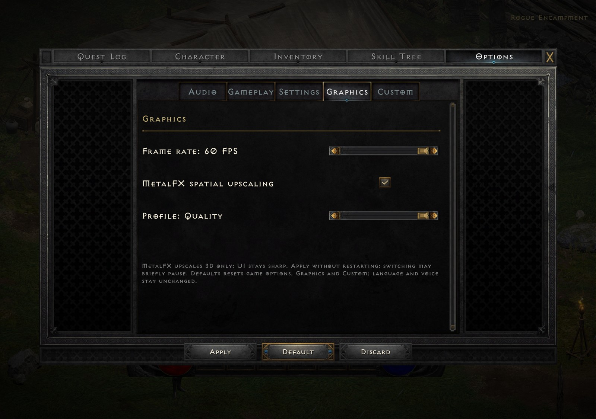

# D2R Mobile Plus

**An iOS interface enhancement fork of [D2R Mobile](https://github.com/jhaizhou-ops/d2r-mobile).**

Maintained by Augustus.

[简体中文](README.zh-CN.md) · [Changelog](CHANGELOG.md) · [Build & verification](docs/PLUS.md) · [Upstream documentation](https://github.com/jhaizhou-ops/d2r-mobile#readme)

D2R Mobile provides the native compatibility layer, Metal renderer, touch controls and controller support for running your own Nintendo Switch edition of Diablo II: Resurrected. **Plus focuses on extensive display optimization for the iPhone Duo inner screen, addressing UI issues in front-end screens, character menus, tab focus, notification frames and loading indicators, with touch and controller refinements.** The upstream project remains the foundation of this work.

This is a development preview. Improvements have been tested locally on an iOS device and in automated tests; comprehensive device, controller and folding-transition coverage is still in progress. “Full screen” describes scene coverage and adaptive layout, not a guarantee that every original game panel has been redesigned.

## Download and verify

- Website: https://d2rplus.augustusplay.com/ · QQ group 1129913678 · This software is free; any paid channel is a resale.
- **Android**: [Releases · android-v1.0.0](https://github.com/augustxxx-debug/d2r-mobile-plus/releases/tag/android-v1.0.0) (source on branch `android/v1.0.0`). Official packages are always signed with the certificate SHA-256 `b4af06c165dd8699ab9f2b0dec8f6c2de05cd4d01f510fe63778eac6898a52da`; anything else is not from us.
- **iOS**: source only — build it with your own game files and Xcode as described under "Build your own copy".

## Coming soon (preview)

Both features below are in development and **expected to open for testing in early November**; dates and scope follow the actual release notes, and test builds may be unstable.

- **AI frame generation (experimental, iOS)**: built on Apple MetalFX machine-learning frame interpolation — the game renders at 60 fps and the screen shows 120 fps, for smoother motion on 120 Hz displays. Only on iPhones that support MetalFX frame interpolation; off by default, enabled from the Graphics tab.
- **Cross-platform co-op (beta)**: iOS, Android and Mac together — up to 4 players in one world, fighting, using portals, picking up loot and saving; runs on our own servers over encrypted connections and does not use any official online service. The first round opens by invitation and widens once it is stable.

## What changes from upstream

| Area | Plus changes | Status |
|---|---|---|
| Front end | Full-screen scene rendering with a centered interface; bottom controls use the available screen area | Implemented; geometry tests and device checks |
| Character screens | Class creation buttons, character-list alignment and bottom actions | Implemented; broader aspect-ratio review pending |
| Panel navigation | Synchronizes selected tabs and refreshes native hover/focus state | Implemented; device checked |
| Notifications | Builds a single frame from your own game artwork, retaining corner details and an opaque center | Implemented; generator tests and device checks |
| Loading indicators | Anchors both the fire-logo animation and red save/loading symbol; prepares placement before revealing the widget | Implemented; captured frame sequences reviewed |
| Quest log touch | Accepts stationary releases longer than the normal tap deadline on quest-specific controls | Implemented; automated tests and device reproduction |
| Optional font | Build-time main-font override with missing-character fallback and `DM_UI_FONT_WEIGHT` stroke-darkening levels | Experimental; ARKai_T inspected locally on device, darkening level 3 accepted on an iPhone Duo, broader layout coverage pending |

These are changes on top of upstream commit [`195ae11`](https://github.com/jhaizhou-ops/d2r-mobile/commit/195ae11dc70f1ba7735c6063e1ed81102e1dbf52). The branch adds experimental MetalFX spatial upscaling; it does not introduce multiplayer or frame generation. Upstream performance measurements and platform support claims are not new benchmarks for this fork.

## MetalFX spatial upscaling (experimental)

Settings retains five separate tabs: **Audio / Graphics / Gameplay / Settings / Custom** (Graphics right after Audio). The original offline Terror Zones control remains in Settings; Graphics uses a separate destination.

Open **Options → Graphics** in game. Enable **MetalFX upscaling (experimental)** to reveal the four-position Auto / Eco / Balanced / Quality slider. Turning the switch off restores the original upscale pass and remembers the selected profile. Frame rate has a separate left/right 30 / 60 FPS selector, plus an experimental 120 FPS stop on 120 Hz screens (see below). Press **Apply** to activate changes without restarting; switching may briefly pause rendering. **Discard** restores the active settings. **Defaults** preserves the native global reset, including game options, Graphics and Custom, while retaining language and voice; press Apply to save. Native Terror Zones and offline difficulty scaling also return to defaults; Discard cancels a pending reset.



*Five-tab revision on device (taken before the tab reorder, when Graphics was fourth): Audio / Gameplay / Settings / Graphics / Custom remain separate; Graphics includes frame-rate selection, the MetalFX switch and four upscaling profiles. The Chinese documentation example uses an optional local font; default builds retain the game font, and no font file is included.*

| Profile | Initial 3D width/height ratio | Behavior |
|---|---|---|
| Auto | 70% or 80% | Chooses by output pixel count; uses 65% in Low Power Mode or serious/critical thermal states, with 60 seconds of stable recovery before raising the ratio; also adapts to frame timing |
| Eco | 60% | Targets lower 3D rendering load; measured energy savings are not guaranteed |
| Balanced | 75% | Balances 3D clarity and rendering load |
| Quality | 85% | Prioritizes a higher 3D ratio |

Auto samples system state at most once per second. Reductions take effect at the next sample; increases require an unchanged healthy target for 60 continuous seconds. Renewed thermal pressure, Low Power Mode or a changed target restarts recovery. Gaps longer than 3 seconds (such as backgrounding or loading) do not count toward recovery. Manual profiles bypass this recovery delay.

The frame-timing controller retains its 3-second post-change hold, approximately 30-second clean recovery, and approximately 90-second recovery after a failed upward step. Auto cap changes retain any further reduction imposed by frame timing; recovering the cap does not reset actual resolution. The game thread receives one final absolute target, avoiding transient cap/level mismatches. Low Power Mode refers to the system switch, not battery percentage. Local state-sequence and production-controller tests cover these timing rules; device stutter and power measurements for this change remain pending.

Ratios apply separately to width and height, not energy savings. Only 3D color is upscaled, retaining the original mask; subsequent UI composition retains its resolution.

### 120 FPS (experimental)

On screens whose maximum refresh rate is at least 120 Hz (ProMotion iPhone / iPad), the Graphics frame-rate selector gets a third stop, **Frame rate: 120 FPS (experimental)**. On other screens the stop does not appear, and a saved 120 setting runs at 60.

- Game logic still runs at 25 ticks per second; every one of the 120 frames is fully rendered by the game (unit and camera positions are interpolated by time), with no inserted or repeated frames.
- On iOS, 120 FPS presents from the present thread instead of the display link: with the in-run touch / HUD overlay on screen, the display-link path was composited at 60 Hz and every other frame was dropped.
- Cost: roughly twice the GPU frames of 60 FPS, more heat. On the iPhone Duo it needs the **Eco** render resolution to hold 120; at higher resolutions the GPU cannot keep up and the 3D ratio controller lowers 3D resolution instead.
- No MetalFX **Quality** at 120 FPS (user decision 2026-10-29, trading a little image quality for memory headroom): with the 120 FPS stop selected the profile slider stops at **Balanced**, a saved Quality runs as Balanced, and a grey line under the profile row says so; 60 / 30 FPS keep Quality. The saved choice is not overwritten, so going back to 60 FPS restores Quality. The diagnostic log records this on lines starting with 「超分档位：」, and the exported summary shows `FPS target=… profileSelected=… profileEffective=… qualityCapped120=…` on one line.
- Status: implemented; device-tested on an iPhone Duo (A20 Pro) inner screen with full effects for about 3 minutes (0 frames dropped by the system, 0.17% late; heavy spawn waves dip to about 100 FPS). Power draw not measured (tested while charging). Not tested on older ProMotion devices, regular iPhones, the Duo outer screen or iPad.
- **iPhone 17 Pro measured (2026-10-29, RC1 cd5ea07, 10 minutes each of a five-act rotation with spawns, on power)**: the 120 FPS stop averages about 60 FPS, typically 56–75 FPS (p10 47 / p50 58.5 / p90 76.5); the 60 FPS stop gives 57 FPS. Peak thermal state 2, no memory warnings. Presentation does run at 120 Hz, but frames are not ready in time: the translation thread takes about 13 ms of CPU per frame (p90 18 ms) and the GPU about 14–15 ms (p90 18 ms), a combined CPU + GPU bottleneck. The 3D ratio controller reaches its 0.60 floor (1573x724) within 8–86 s and stays there, so over 10 minutes the three MetalFX profiles differ by only about 1.5 ms (Quality 15.3 / Balanced 14.7 / Eco 13.8 ms). Eco render resolution cuts GPU time by about 30% to roughly 10.4 ms, and the translation thread does not scale with resolution, so lowering resolution cannot reach 120 FPS. 120 FPS stays an experimental opt-in on the 17 Pro. Falling back to 60 FPS pacing at thermal state 2 or above is planned for RC2.
- The diagnostic log records the effective frame rate and present path on lines starting with 「帧率档：」, which the exported diagnostics summary includes.

### Render resolution (whole-frame output cap)

The 3D ratio above never touches the UI layer, the final composite, the upscale pass or the present blit, which all run at the full output size. On very dense screens that part dominates GPU time: the iPhone Duo inner screen renders the game at 2852x2006 (about 5.7 MP, 2.8x the Switch's 1080p), and on-device logs showed the same ~15 ms GPU frame with MetalFX Eco and with the original upscaler once the 3D ratio had reached its 0.60 floor. The Graphics tab therefore has a fourth row, **Resolution**, a four-position slider that caps the whole-frame output size by pixel budget; the present thread's existing aspect-preserving bilinear upscale fills the screen again, UI rectangles and touch coordinates are relative and unchanged, and the change applies live with Apply (the game re-reads its output size through the same notification the foldable screen switch uses).

| Level | Pixel budget | Effect |
|---|---|---|
| Auto (default) | By GPU generation: A16 and earlier 2.07 MP, A17 Pro / A18 2.8 MP, A18 Pro / A19 3.8 MP, A19 Pro / A20 and later 4.0 MP, M series 4.5 MP | 17 Pro Max (A19 Pro) and the Duo outer screen unchanged; screens above 4.5 MP (the Duo inner screen) take the Balanced 2.8 MP budget instead and shrink to about 1994x1402, because at native size the GPU sat at ~15 ms per frame under full-screen spell effects while Eco ran at ~10 ms with identical fps; 15 Pro (A17 Pro) to about 0.96x edge; 14 Pro and earlier to about 0.83x |
| Eco | 2.07 MP | 1080p-equivalent pixel count on every device |
| Balanced | 2.8 MP | Between the two |
| Native | no cap | Previous behavior: output size = window size |

Auto also has a measured closed loop on top of the table: when the 3D ratio is already at its floor and frames keep dropping (over 5% in the last 10 s or over 1.5% over 60 s), the whole-frame output steps down once more (Balanced 2.8 MP → Eco 2.07 MP) and steps back up after 60 s without drops; every change holds for 10 s. Any chip and thermal state therefore converges on measured frame pacing, and the generation table is only the starting point. Active only in Auto and not in "quality first"; `DM_RES_AUTO_OFF=1` pins it for measurements.

The cap only ever shrinks and keeps the window aspect ratio within 0.5%, so no black bars appear. The startup reserve is not reduced, so the level can be raised again at runtime without restarting. Status: implemented with unit tests for the budget math and the settings plumbing (`dm/host/tests/t_res_cap.c`, `t_render_profile.c`, `dm/ios/tests/test_touch_layout_options.py`); **not yet verified on a device**, and no power or GPU-time measurement for it exists yet. The slider is read by the iOS front end only; the Mac host keeps native output. The frame-rate setting is independent. Auto, Eco and Balanced can reduce 3D resolution further during sustained frame drops. Unsupported devices or initialization failure retain the original upscale pass automatically.

### Ray-traced shadows (experimental)

A separate **Ray-traced shadows (experimental)** checkbox on the Graphics tab, off by default. The row appears only on devices that pass all three checks: `supportsRaytracing`, GPU family Apple9 or later, and a model allowlist (iPhone 15 Pro / A17 Pro and later, iPad Pro M4 and later, Macs with M3 and later); everywhere else the setting is treated as off and the original shadow maps are used. Metal 4 path only.

What it does when on:

- **Occluders.** Shadow-pass draws become instances of per-mesh acceleration structures. Meshes are cached by their full index and vertex content; at most 32 new meshes / 60,000 triangles are built per frame; the cache has a 64 MB byte budget (`DM_RT_SHADOW_CACHE_MB`) and is released once the GPU is done with it when the switch is turned off. Characters and monsters use their real pose (skinned positions exported by `_pos` vertex variants, then refit). Alpha-tested occluders such as foliage, fences and dither-faded models are judged at each hit by the game's own fragment shader, rewritten at packaging time (`DM_RT_ALPHA=0` keeps them in the original map).
- **Sun.** The sun is the light of the largest square shadow map (the cascade). Right before the main opaque pass, one occlusion ray per pixel is traced toward the sun. Sun shadow draws that are in the acceleration structure are no longer drawn into the shadow map; draws that are not (a new mesh still being built, the build quota for the frame used up, an unsupported primitive or format) are drawn as original. The 230 main-pass fragment shaders that sample the cascade are swapped for `_rt` variants, generated at packaging by `dm/gfx/tools/rts_variant.py` (packaging stops if a required variant fails to compile), that take the darker of the ray-traced mask and the shadow-map sample (partial fallback). Other shadow maps (the top-down soft shadow, hair) stay original. A frame that cannot use the mask (no camera or main pass, a failed trace) binds a fully lit mask of the render-target size and so shows the original shadows; if no mask covers the render target, the variant is not selected and the original shading runs. A hysteresis keeps the picture from flipping between the two.
- **Point lights.** Up to 2 point lights per frame, the brightest ones closest to the centre of the view, gathered on the GPU (`DM_RT_POINT_N`, at most 4; `DM_RT_POINT=0` turns them off), traced at quarter resolution within each light's radius. The character's own light is recognised and weakened to 0.8× (`DM_RT_PLAYER_LIGHT`). Levels without a sun (indoors, underground) trace point lights only and are not darkened.
- **Automatic levels.** When the frame's GPU time is above 92% of the present budget and ray tracing above 12% for 1 s, it steps down one level; below 70% for 8 s, it steps back up. Frames that build more than 20,000 triangles of meshes and the first 180 traced frames are not counted. Every level keeps ray tracing:

  | Level | Sun | Point lights | Skinned characters / monsters | Dither-faded characters / monsters | Static alpha-tested (leaves, grass, fences) | AO |
  |---|---|---|---|---|---|---|
  | 0 | full resolution | as configured (2) | ray traced | ray traced, judged | ray traced, judged | as configured (off) |
  | 1 | full resolution | ≤ 2 | ray traced | ray traced, judged | ray traced, judged | off |
  | 2 | half resolution, depth-aware upsampling | 1 (character's own light excluded) | ray traced | ray traced, judged | ray traced, judged | off |
  | 3 | half resolution, depth-aware upsampling | off | ray traced | ray traced as opaque silhouettes | original shadow map | off |

  `DM_RT_LEVEL=<0–3>` pins a level, `DM_RT_AUTO=0` turns automatic off, `DM_RT_SUN_HALF=1` keeps the sun at half resolution.
- **GPU hang protection.** If a command buffer reports a GPU hang while ray tracing is on, the first time ray tracing pauses for 120 s (original shadows) and resumes at level 3; the second time it is turned off for the rest of the run.
- **Ray-traced AO (experimental)**, off by default (`DM_RT_AO=1`): half-resolution hemisphere rays that firm up wall bases, stone gaps and contact points; it turns off from level 1. 
- **Soft shadows**, on by default at strength 2: contact-hardening (firm at the feet, soft further out), a depth-aware blur scaled by the hit distance (`DM_RT_SOFT=0` restores hard shadows). Active at levels 0 and 1; from level 2 they switch to half-resolution hard shadows. In a same-run comparison on a Mac M4 Pro they cost about 2 ms more GPU time per frame than hard shadows. Measured on an iPhone 17 Pro, the downgrade is triggered by whole-frame GPU time (not memory): at 120 FPS the budget is 8.33 ms and the game alone takes about 14 ms, so ray tracing drops to level 3 within seconds and **soft shadows do not apply at 120 FPS** (half-resolution hard shadows, point lights off); at 60 FPS light scenes (the camp) stay at level 0 with soft shadows (ray tracing about 3–4 ms), large fights or loading hitches drop to levels 2–3, and it steps back up once the frame stays under 70% of the budget for 8 seconds.
- **Ray origin.** The surface normal is rebuilt from depth (the game camera is orthographic with reversed depth; the near plane is decided per frame from the camera matrix). Back-facing surfaces (N·L < 0) are not traced and count as shadowed (the original darkens them through its shadow map); the normal is smoothed over a 2-pixel neighbourhood and soft shadows get a minimum blur radius of 2 pixels, so the boundary does not break into specks; lit surfaces move 1 × (1 − N·L) along the normal and then 0.6 toward the sun (`DM_RT_SHADOW_NL` / `DM_RT_SHADOW_NBIAS` / `DM_RT_SHADOW_BIAS`). This removes the self-occlusion blotches on the shaded side of characters and summons. Ray-traced AO uses the same normal.
- **Render resolution.** When ray tracing is on at startup, the render resolution drops one level automatically: Native → Balanced, Balanced → Eco, Eco unchanged, Auto → closed-loop step 1. The game builds its render targets at the startup size and never shrinks them, so this is decided only at startup and caps the output for the whole run; changing the ray-tracing setting takes effect at the next launch. `DM_RT_RES_DROP=0` turns it off.
- **Diagnostics.** The startup log reports the device check, the effective state, fallbacks with their reason, per-map light directions, draws outside the acceleration structure by reason, level changes and GPU time (prefixes 「光追阴影：」, 「光追降档：」, 「光追镂空：」, 「光追点光：」, 「光追 AO：」, 「光追质量：」, 「光追降分辨率：」); the share-diagnostics summary carries these lines.

Status: experimental. On a Mac M4 Pro (fixed seed, level pinned, camp, Dark Wood, Underground Passage level 1) ray tracing costs about 2.8–4.0 ms of GPU time per frame at levels 0–2 and 1.1–1.5 ms at level 3. On an iPhone Duo (A20 Pro), an earlier build settled at the lowest level at the camp; the current levels have **not yet been measured on a device**, and holding 60 FPS at level 3 is an estimate. Known limits: at level 3 torches cast no ray-traced shadow (point lights off); cave walls, stalagmites and torch stands do not block point lights (they are not in the game's shadow pass); no power measurement.

**Known issues:** measured on an iPhone 17 Pro, ray tracing steps down to level 2 or lower by frame time soon after it turns on; **at 120 FPS there are only half-resolution hard shadows (plus the render resolution one level down from startup) and soft shadows do not apply**, and soft shadows stay only in light scenes at 60 FPS; the ray-traced shadow tip is about 14% longer than the original cascade shadow; from downgrade level 2 shadows are half-resolution and hard; toggling ray tracing mid-run changes the render resolution only at the next launch; on the native Mac host ray tracing adds a fixed ~585 MB of resident memory (independent of resolution; not yet measured on a device); the back sides of thin geometry (fence logs, branches) are darker than the original (its shadow map cannot cast that self-occlusion); surfaces the original keeps out of its shadow pass (cave walls, stalagmites, torch stands) are darker on their back sides too - back faces always count as shadowed, which is grounded only for closed casters in the original shadow pass (characters, monsters); at the camp the same-frame deviation from the original in both directions together goes 3.96% → 5.78% (Blood Moor 1.81% → 1.61%); when on-screen skinned / alpha-tested units exceed the export quota of 1024 per frame, or their instance slots reach the mesh cache cap, the alpha-tested ones (characters and monsters in the game fade with dithering, so they all are) use the original shadow map, so one unit can switch between a ray-traced and an original shadow; skinned meshes without alpha testing already use the original shadow when the cache cap is reached or allocation fails, but in the other over-limit cases (export quota full, per-frame slot busy, 128 slots full) they still enter ray tracing in their bind pose (wrong shadow shape; counted 0 in 107 Mac runs and 18 device logs), to be moved to the original shadow map in RC2; a refused slot does not itself trigger mesh eviction, so after a scene change old meshes are usually released after about 600–720 unused frames (earlier if a newly built mesh pushes the cache over its budget), and new units may use original shadows meanwhile; the reduced-resolution sun (1/2 at both levels 2 and 3) samples the block-centre pixel, half a pixel off the position the upsampling assumes, so for some sun directions back-face 0 still leaks onto adjacent lit pixels (auditor case, 1/2 resolution, four directions: 22 / 68 / 74 / 5 pixels); RC2 makes the upsampling interpolate at the actual sample positions (measured 13 / 12 / 4 / 10), and dark streaks remain on fur such as the bear's, more visible at downgrade levels 2 / 3 (the usual state at 120 FPS: hard shadows, no blur) - the normal rebuilt from depth is noisy on fur; left to RC2. Also: it applies only in a run, the main menu / character select keep the original look; under memory pressure (system memory warnings) it releases its caches and steps down, log prefix "光追内存：".

### Exploratory device power probe

These are historical readings from before the current local audit fixes. No new phone power measurement was performed during the audit.

Each profile was run on the same device and test save, with a fixed seed and time on Blood Moor using the same scripted encounter: six in-game enemies and identical skill inputs. The frame-rate target was 60, display brightness was 100%, and the device was unplugged with no active cooler. FPS and GPU timings below come from the game runtime logs; the power column is the whole-device battery drain rate estimated by Apple Power Profiler.

| Profile | FPS at about 30 s | GPU average / p95 | Power probe |
|---|---:|---:|---:|
| Auto | 59.9 FPS | 11.74 / 15.68 ms | 37.2%/hr |
| Eco | 59.8 FPS | 14.58 / 16.55 ms | 44.5%/hr |
| Balanced | 60.0 FPS | 14.71 / 16.01 ms | 48.5%/hr |
| Quality | 53.9 FPS | 18.56 / 19.74 ms | 31.2%/hr |
| Original | 60.0 FPS | 12.03 / 15.83 ms | 32.6%/hr |

**These readings cannot rank profile power use and must not be interpreted as savings percentages or watts.** Each profile has only one approximately 0.95-second power snapshot; Power Profiler then reported a device disconnect instead of recording the requested 8 seconds. Thermal states also differed between runs (for example, Quality reached a higher thermal state later), and the readings do not track rendering load consistently. The table preserves the exploratory observations and the measurement limitation; it does not claim that any profile saves power. A reliable comparison requires sustained device power sampling and repeated runs at matched thermal states.

See [build and verification notes](docs/PLUS.md) for other checks and limitations.

## Community entry and About

"Join the community" in the pause menu, on the front-end main menu and at the end of the Custom options page opens one in-game box: one card per channel, each with its own Copy: the Chinese UI shows the QQ group and the website, other languages the website and GitHub; the footer holds the version and credits. All of them come from the `community` field of the remote version file (sample: `docs/community_manifest.sample.json`); without that field the entry is hidden. Only the group and the repository address are shown, never any personal contact.

## Notification example

The frame is generated from the game’s button artwork, preserving its decorative ends. The wider text area accommodates longer English notifications.


*Device UI demonstration. Game imagery belongs to its respective rights holders. No account/device information or save files are included; image metadata has been removed.*

## Branches

- `main` preserves the upstream baseline used for this preview.
- `codex/plus` contains the Plus changes and these documents.

Review the [changelog](CHANGELOG.md) for scope, validation and remaining limitations before updating. Back up saves before changing builds or signing identities.

## Build your own copy

Bring your own legally obtained game files and your own signing configuration. This repository contains no game program, game resources, saves, commercial fonts, signing certificates or installation packages.

```sh
git clone --branch codex/plus https://github.com/augustxxx-debug/d2r-mobile-plus.git
cd d2r-mobile-plus
./setup.sh check
```

Follow the upstream [game-file preparation guide](docs/GAME_FILES.md), [workspace setup](dm/README.md) and [iOS build guide](dm/ios/README.md). After preparing the workspace and local signing configuration, build with `cd dm/ios && ./run.sh build`. Configuration and generated resources remain local and ignored by Git.

The font override is **off by default**. See [optional font configuration](docs/PLUS.md#optional-font) for its dependencies, scope and limitations. No font file is in the repository. Public packages built by this project use **LXGW WenKai** (霞鹜文楷, Medium weight, the same face and darkening level as the Android package), released under the SIL Open Font License 1.1 (see Credits); any other font, such as the commercial AR ZhongkaiGBK used in earlier local tests, is for the owner's private builds only and must never be redistributed.

## Memory tiers (support matrix)

Devices differ in RAM and in the memory limit the system grants one app, and Apple does not publish per-model numbers. Graphics defaults are therefore chosen **by this device's actual memory limit, not by a model list**.

- The limit is `phys_footprint + os_proc_available_memory()`, read at launch before the game allocates its heap.
- Thresholds use that limit, not physical RAM.
- A build with the `increased-memory-limit` entitlement gets about 6 GB and lands in the top tier.

| Tier | Process memory limit | 120 FPS | Default MetalFX profile | Default render resolution | Notice |
|---|---|---|---|---|---|
| 2 | ≥ 3200 MB | Available (experimental; no Quality at 120) | Auto (unchanged) | Auto (unchanged) | None |
| 1 | 2600–3199 MB | Hidden; the Graphics frame-rate row says why | Eco | Balanced | None |
| 0 | < 2600 MB | Hidden; the Graphics frame-rate row says why | Eco | Eco | One-time main-menu notice "Graphics lowered automatically" |

- Tier defaults apply only on first run or when the tier changes, and only to settings still at the previous default. Values the player changed are kept, and Graphics stays adjustable as usual.
- **Only two devices are measured**: iPhone 17 Pro (iPhone18,1) and iPhone Duo (iPhone19,4). Both have a 3375 MB limit without the entitlement, so both are tier 2.
- Every other device falls into a tier by the limit it reads at launch:
  - 4 GB models are estimated at tier 0;
  - 6 / 8 GB models are still to be measured.
- The launch log and the shared diagnostics summary carry one line, "内存档位：上限 X MB / 物理 Y GB / 机型 Z → 档位 N", which shows the tier of a reported device.
- Tiers 1 / 0 shrink the render reserve at launch, before the game builds its render targets, to the render-resolution level in effect then. The game sizes its targets at launch, and lowering resolution mid-run returns no memory. So on these tiers a higher resolution applies only after a restart, and the Graphics resolution row says so.
- The diagnostics summary records both the launch values and the current settings (`Memory tier=… atLaunch … now …`).
- For debugging, `DM_MEM_TIER=0/1/2` forces a tier.

**Known issue (memory, free signing):** packages signed with a free developer account lack the `increased-memory-limit` entitlement, so the per-process limit is about 3375 MB (same on both test phones). In long 120 fps sessions the footprint levels off near 2.7 GB and the system **keeps sending memory warnings** (about 700 in a 43-minute run on an iPhone 17 Pro), but the app is not terminated. The known host-side leak (retired objects never destroyed) is fixed, and retired objects, command allocators and view caches are reclaimed. Earlier long runs show the footprint levelling off late in the session (about +0.008 MiB/s after minute 30 in the 60-minute cd5ea07 run), but late-session slopes differ between runs (about +0.07 MiB/s over the last 15–20 minutes of the 43-minute b57a76f run); whether the current candidate has no residual growth is decided by its own long run. The remaining growth is mostly the game's own memory pool being counted into the footprint, which the host cannot reclaim. Packages signed with a paid account carry the entitlement (limit about 6 GB) and do not have this issue.

## Verification and limitations

The preview has passed focused host geometry/classification tests, the iOS touch suite, notification generator checks and a signed device build. The quest narration issue was reproduced before the change and retested after it. See [verification details](docs/PLUS.md#verification) for the checks actually performed and those still pending.

**Large black bars on both sides (on an iPhone)**: the package itself is universal (iPhone + iPad). If the signing tool's "iPad mode" is on (device type set to iPad), iOS runs it on the iPhone as an iPad app in compatibility mode, at the iPad aspect ratio (about 1.44:1) with black bars on both sides that the game cannot remove. Turn off "iPad mode", set the device type to iPhone, re-sign and reinstall. The app detects this at launch: the log says it is running with the iPad identity, and one alert is shown after entering the game.

Physical folding transitions, complete controller navigation, all achievement/notification combinations and every game panel still need broader regression testing. Please report reproducible cases with screen dimensions, input mode, steps and the source commit. Remove personal information from diagnostics before sharing; do not upload game files, keys, saves or signed packages.

## Credits and license

Based on [D2R Mobile](https://github.com/jhaizhou-ops/d2r-mobile), with thanks to its author and contributors. Existing copyright notices and the [MIT license](LICENSE) are retained. Diablo II: Resurrected and its assets belong to their respective rights holders. This is an independent community project.

**Font.** Public packages embed [LXGW WenKai](https://github.com/lxgw/LxgwWenKai) (霞鹜文楷, Medium weight) by LXGW, derived from Fontworks' Klee One, as the optional main UI font, subset to the characters the game and this project use, with the game's own font retained for Western glyphs and icons. LXGW WenKai is licensed under the [SIL Open Font License 1.1](https://openfontlicense.org/) with Reserved Font Names "霞鹜", "霞鶩", "落霞孤鹜", "落霞孤鶩" and "LXGW"; the licence text (OFL.txt) ships next to the font in the build environment and is not modified. The embedded font is a modified version in the OFL sense: version 1.530 of the Medium face, subset to the characters in use and merged with the game font, and the merged font carries the game font's registration name, not a Reserved Font Name. The font's copyright notice and the full licence text ship inside every package as `UIFonts/FONT_LICENSE.txt` (written at build time next to the generated font; a build whose font comes from a public font directory fails if no licence file sits beside the font, and a font from a private directory is only accepted with `DM_PRIVATE_FONT=1`). The font is not stored in this repository; it is fetched from the upstream release by whoever builds a package. Thanks to LXGW for the typeface.
