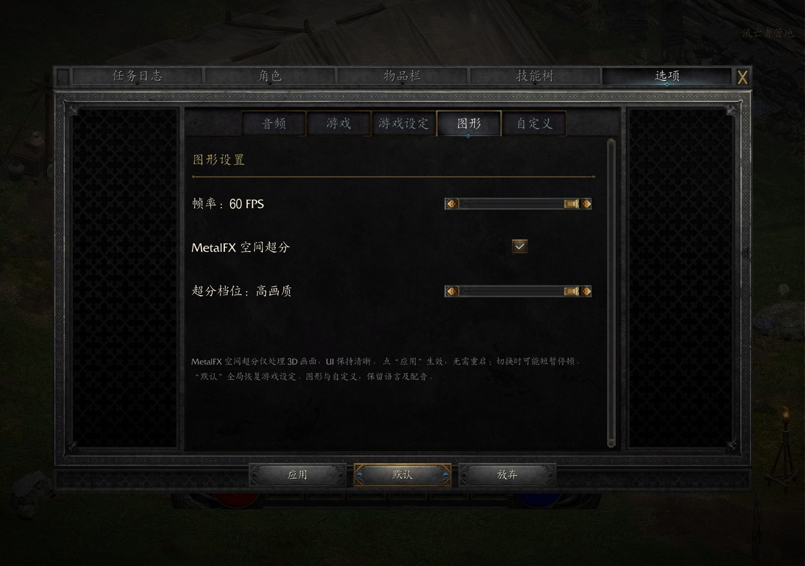
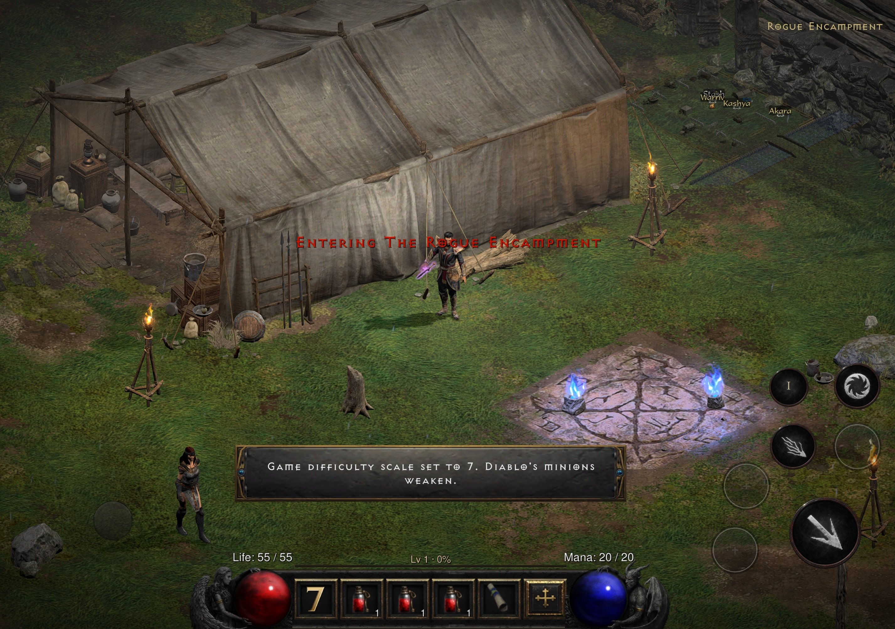

# D2R Mobile Plus

**基于 [D2R Mobile](https://github.com/jhaizhou-ops/d2r-mobile) 的 iOS 界面增强分支。**

制作：Augustus

[English](README.md) · [更新日志](CHANGELOG.zh-CN.md) · [构建与验证](docs/PLUS.zh-CN.md) · [上游说明](https://github.com/jhaizhou-ops/d2r-mobile/blob/main/README.zh-CN.md)

D2R Mobile 提供原生兼容层、Metal 渲染、触控与手柄支持，让玩家运行自己持有的 Nintendo Switch 版《暗黑破坏神 II：狱火重生》。**Plus 重点针对 iPhone Duo 内屏深入优化显示，修复前端、角色界面、标签焦点、通知边框和加载标志等多处 UI 问题，并完善触控与手柄操作。** 所有增强均建立在上游项目的基础之上。

当前为开发预览版。改动已经过本地 iOS 实机与自动化测试，但完整的设备、手柄和折叠切屏覆盖仍在进行。“全屏”指场景覆盖和自适应布局，并不代表所有原版面板都已重新设计。

## 相比上游改了什么

| 范围 | Plus 改动 | 状态 |
|---|---|---|
| 前端界面 | 场景全屏渲染，交互界面居中；底部控件按可用屏幕区域布局 | 已实现；几何测试与实机检查 |
| 角色界面 | 职业创建按钮、角色列表对齐与底部操作布局 | 已实现；更多宽高比仍待复查 |
| 面板导航 | 同步选中标签，刷新原生悬停与焦点状态 | 已实现；实机检查 |
| 通知 | 从玩家自己的游戏素材生成完整边框，保留角部细节并使用不透明中心 | 已实现；生成器测试与实机检查 |
| 加载标志 | 同时处理火焰字样动画和红色存档／加载符号；先定位再显示 | 已实现；已检查连续截图 |
| 任务日志触控 | 任务专用控件允许超过普通点击时限的原地松手操作 | 已实现；自动化测试与实机复现 |
| 可选字体 | 构建时替换主字体，保留缺字回退，`DM_UI_FONT_WEIGHT` 可按档加深笔画 | 实验功能；已在本地实机检查 ARKai_T，加深 3 档已在 iPhone Duo 上验收，仍需更全面布局验证 |

以上改动基于上游提交 [`195ae11`](https://github.com/jhaizhou-ops/d2r-mobile/commit/195ae11dc70f1ba7735c6063e1ed81102e1dbf52)。本分支加入实验性 MetalFX 空间超分；未加入多人联机或插帧。上游的性能测量与平台支持说明不等同于本分支的新测试结果。

## MetalFX 空间超分（实验功能）

设置页完整保留 **音频／图形／游戏／游戏设定／自定义** 五个标签（图形紧跟音频）。“游戏设定”仍包含原版离线恐惧区域开关；新增图形页使用独立目的页。

入口：游戏内 **选项 → 图形**。开启 **MetalFX 空间超分（实验性）** 后显示自动／省电／均衡／高画质四档滑块；关闭开关会恢复原有放大通道，并记住上次选择的档位。帧率使用独立的左右切换控件选择 30／60 FPS；120 Hz 屏上另有实验性的 120 FPS 一格（见下）。点 **应用** 后即时生效，无需重启；切换时可能短暂停顿。点 **放弃** 恢复已生效的设置。**默认** 沿用原版全局重置，包含游戏设定、图形与自定义，保留语言及配音，再点应用保存。原版恐惧区域与离线难度人数也会恢复默认；放弃可撤销待应用的重置。



*五标签版实机截图（调整页签顺序之前拍的，当时图形在第四位）：音频／游戏／游戏设定／图形／自定义完整保留；图形页包含独立帧率控件、MetalFX 开关和四档超分。中文示例启用了本地可选楷体；默认构建使用游戏原字体，仓库不包含字体文件。*

| 档位 | 初始 3D 宽高比例 | 行为 |
|---|---|---|
| 自动 | 70% 或 80% | 根据输出像素数选择；低电量模式或系统严重／危急温控状态降至 65%，恢复须连续稳定 60 秒；继续按实际帧间隔调整 |
| 省电 | 60% | 降低 3D 渲染负载；名称表示策略目标，实际节电幅度需要测量 |
| 均衡 | 75% | 平衡 3D 清晰度与负载 |
| 高画质 | 85% | 优先保持较高 3D 比例 |

自动档每秒最多读取一次系统状态：降档在下次采样生效，回升须目标比例连续稳定 60 秒；温度反复变化、低电量模式再次开启或目标比例变化会重新计时。超过 3 秒没有有效采样（如后台或加载）不计入恢复时间。手动档位直接生效，不受这段恢复等待限制。

实际掉帧控制仍保留切换后 3 秒停判、约 30 秒稳定后升档，以及刚升又掉时延长至约 90 秒的保护。自动档改变上限时会保留实际掉帧造成的进一步降档，上限恢复也不会直接清掉降档状态；游戏线程一次接收最终绝对比例，避免新旧档位混用造成瞬间反跳。此处低电量指系统低电量模式，不是电池百分比。这些时间规则已通过本地状态序列及生产控制器入口测试，尚未在设备上验证本次修改的卡顿或功耗表现。

比例是宽、高各自的比例，不是省电百分比。超分只作用于 3D 颜色，保留原版遮罩，之后绘制的界面不随之降低分辨率。

### 120 帧（实验性）

屏幕最高刷新率不低于 120 Hz（ProMotion iPhone／iPad）时，图形页帧率控件多出第三格 **帧率：120 FPS（实验性）**；其他屏幕上不出现这一格，已存的 120 设置按 60 运行。

- 游戏逻辑仍是每秒 25 拍；120 帧每一帧都由游戏完整渲染（单位与镜头位置按时间插值），没有插帧或重复帧。
- iOS 上 120 帧改由出图线程自取画布上屏，不用显示节拍对象：局内触控／HUD 叠层显示时，显示节拍路径会被系统按 60 Hz 合成、隔一帧丢一帧。
- 代价：GPU 帧数约为 60 帧的两倍，发热更多。iPhone Duo 上要配 **省电** 渲染分辨率才能稳住 120；分辨率更高时 GPU 跟不上，3D 比例控制器会转而降低 3D 分辨率。
- 状态：已实现；iPhone Duo（A20 Pro）内屏满特效实测约 3 分钟（系统丢弃 0 帧、晚到 0.17%；刷怪最密时约 100 帧）。功耗未测（测试时在充电）。老款 ProMotion 设备、普通 iPhone、Duo 外屏、iPad 未测。
- 诊断日志用「帧率档：」开头的行记录生效帧率与出图路径，导出的诊断摘要会带上这两行。

### 渲染分辨率（整帧输出上限）

上面的 3D 比例不影响界面层、最终合成、放大通道和出图这几遍整屏处理，它们都按输出尺寸跑。在像素密度很高的屏幕上这部分才是 GPU 的大头：iPhone Duo 内屏的游戏输出是 2852x2006（约 572 万像素，Switch 1080p 的 2.8 倍），真机日志里 3D 比例降到 0.60 下限后，MetalFX 省电档与原版放大的 GPU 每帧都约 15 ms。因此图形页新增第四行 **渲染分辨率** 四档滑块，按像素预算给整帧输出尺寸设上限；出图线程现有的保持比例的双线性放大负责铺回屏幕，界面矩形与触控坐标都是相对值、不受影响，点应用即时生效（游戏通过与折叠屏换屏相同的通知重读输出尺寸）。

| 档位 | 像素预算 | 效果 |
|---|---|---|
| 自动（缺省） | 按 GPU 代际：A16 及以前 207 万、A17 Pro／A18 280 万、A18 Pro／A19 380 万、A19 Pro／A20 及以后 400 万、M 系列 450 万 | 17 Pro Max（A19 Pro）与 Duo 外屏不变；原生超过 450 万像素的屏（Duo 内屏）改取均衡档 280 万预算，缩到约 1994x1402，因为满屏法术特效下原生档 GPU 全程约 15 ms 饱和而省电档约 10 ms、帧率相同；15 Pro（A17 Pro）缩到约 0.96 倍边长；14 Pro 及更早缩到约 0.83 倍 |
| 省电 | 207 万 | 所有设备按 1080p 等量像素渲染 |
| 均衡 | 280 万 | 介于两者之间 |
| 原生 | 不限制 | 原来的行为：输出尺寸 = 窗口尺寸 |

自动档还有一层按实测闭环的调节：当 3D 比例已经降到下限仍持续掉帧（最近 10 秒超过 5% 或 60 秒超过 1.5%），整帧输出再降一步（均衡 280 万 → 省电 207 万），连续 60 秒不掉帧再逐步升回；每次变档停判 10 秒。这样不同芯片和温度下都按实际帧率收敛，机型表只是起点。只在自动档且未选“画质优先”时生效，`DM_RES_AUTO_OFF=1` 可在测量时钉住。

上限只缩不放，宽高比误差保持在 0.5% 以内，不会出现黑边。启动预留尺寸不缩，所以运行中可以把档位再调回原生而无需重启。状态：已实现，预算计算与设置链路有单测（`dm/host/tests/t_res_cap.c`、`t_render_profile.c`、`dm/ios/tests/test_touch_layout_options.py`）；**尚未真机验收**，也还没有针对它的功耗或 GPU 时间测量。滑块只由 iOS 前端读取，Mac 宿主仍按原生输出。帧率开关独立；自动／省电／均衡仍可能因持续掉帧进一步降低 3D 比例。不支持 MetalFX 或初始化失败时自动保留原版放大通道。

### 光追阴影（实验性）

图形页上单独的 **光追阴影（实验性）** 勾选框，缺省关。只有同时通过三重判定的机器才显示这一行：`supportsRaytracing`、GPU 家族 Apple9 及以后、机型白名单（iPhone 15 Pro / A17 Pro 及以后、iPad Pro M4 及以后、M3 及以后的 Mac）；其余机器一律按关处理、沿用原版阴影图。只有 Metal 4 路径。

开启后的行为：

- **遮挡体**：阴影通道的绘制变成按网格缓存的加速结构的实例。网格按全部索引与顶点内容缓存；每帧最多新建 32 个网格、合计 6 万三角形；缓存有 64 MB 字节预算（`DM_RT_SHADOW_CACHE_MB`），关掉开关后等 GPU 用完整体释放。人物和怪按真实动作投影（`_pos` 顶点变体导出蒙皮位置后 refit）。树叶、栅栏、抖动淡出的模型等镂空遮挡体，在每个命中处用游戏自己的片元着色器判定挡不挡（出包时改写；`DM_RT_ALPHA=0` 让它们留在原阴影图）。
- **太阳**：太阳取最大那张方形阴影图（级联）的光源。主不透明通道之前，每像素向太阳追一条遮挡射线。进了加速结构的太阳阴影绘制不再画进阴影图；没进的（新网格还在建、本帧建网格配额用完、不支持的图元或格式）照原版画进去。主通道里采样级联的 230 个片元着色器换成 `_rt` 变体（出包时由 `dm/gfx/tools/rts_variant.py` 生成，必需变体编不过时出包停下），取光追遮罩与阴影图采样的较暗值（局部回退）。其他阴影图（俯视软影、头发）照原版。用不上遮罩的帧（缺相机或主通道、追踪失败）绑渲染目标尺寸的全亮遮罩，显示原版阴影；遮罩盖不住渲染目标时不选变体、照原版着色。画面迟滞避免两种画面来回切换。
- **点光**：每帧至多 2 盏，挑离画面中心近且亮的，在 GPU 上收集（`DM_RT_POINT_N` 最多 4，`DM_RT_POINT=0` 关），1/4 分辨率、只在灯光半径内追。角色随身光会被认出并减弱到 0.8 倍（`DM_RT_PLAYER_LIGHT`）。没有太阳的关卡（室内、地下）只追点光，画面不压暗。
- **自动降档**：整帧 GPU 超过出图预算的 92%、且光追超过 12%，持续 1 秒降一档；低于 70% 持续 8 秒升一档。建网格超过 2 万三角形的帧和开局头 180 个追踪帧不计。每一档都有光追：

  | 档 | 太阳 | 点光 | 蒙皮人物 / 怪 | 抖动淡出的人物 / 怪 | 静态镂空（树叶、草、栅栏） | AO |
  |---|---|---|---|---|---|---|
  | 0 | 全分辨率 | 按设置（2 盏） | 光追 | 光追 + 判定 | 光追 + 判定 | 按设置（关） |
  | 1 | 全分辨率 | ≤ 2 盏 | 光追 | 光追 + 判定 | 光追 + 判定 | 关 |
  | 2 | 半分辨率 + 深度感知上采样 | 1 盏（排除随身光） | 光追 | 光追 + 判定 | 光追 + 判定 | 关 |
  | 3 | 半分辨率 + 深度感知上采样 | 关 | 光追 | 光追（不透明剪影） | 原版阴影图 | 关 |

  `DM_RT_LEVEL=<0–3>` 钉档，`DM_RT_AUTO=0` 关掉自动，`DM_RT_SUN_HALF=1` 太阳一直半分辨率。
- **GPU 挂起保护**：光追开着时命令缓冲报 GPU 挂起，第一次暂停光追 120 秒（原版阴影），之后从第 3 档恢复；第二次本次运行关掉光追。
- **光追 AO（实验性）**，缺省关（`DM_RT_AO=1` 打开）：半分辨率半球射线，墙脚、石缝、贴地处更实；第 1 档起自动关。软阴影可选：`DM_RT_SOFT=<强度>`（缺省硬阴影）。
- **诊断**：启动日志记机器判定、生效状态、回退及原因、各阴影图的光源方向、没进加速结构的绘制按原因计数、降档和 GPU 耗时（前缀「光追阴影：」「光追降档：」「光追镂空：」「光追点光：」「光追 AO：」），分享诊断日志摘要里都有。

状态：实验性。Mac M4 Pro 上（固定种子、钉档，营地、黑暗森林、地下通道一层）光追每帧 GPU 约 2.8–4.0 ms（第 0–2 档）、1.1–1.5 ms（第 3 档）。iPhone Duo（A20 Pro）上，早先一个版本在营地最终停在最低档；现在的档位**还没在真机上测过**，第 3 档能稳 60 帧只是估算。已知局限：第 3 档关点光，火把没有光追影；洞壁、石笋、火把架不挡点光（它们不在游戏的阴影通道里）；没有功耗数据。

**已知问题（RC2 修）**：角色可能出现双影；阴影为硬边，观感尚不及原版软阴影。另外：只在局内生效，主菜单 / 选角页照原版；内存紧张时（系统内存告警）自动放掉缓存并降档，日志前缀「光追内存：」。

### 实机战斗功耗探测（探索性数据）

以下是本次本地审计修复之前的历史读数；审计期间没有新增手机功耗测量。

在同一台设备上，使用同一份测试存档、固定随机种子和时间，在鲜血荒地进行固定战斗脚本：6 个游戏内敌人、相同技能输入，帧率目标 60；屏幕亮度为 100%，未充电、无主动散热。下表的帧率与 GPU 时间来自游戏运行日志；功耗栏是 Apple Power Profiler 给出的整机电池消耗率估值。

| 档位 | 约第 30 秒帧率 | GPU 平均 / p95 | 功耗探针读数 |
|---|---:|---:|---:|
| 自动 | 59.9 FPS | 11.74 / 15.68 ms | 37.2%/小时 |
| 省电 | 59.8 FPS | 14.58 / 16.55 ms | 44.5%/小时 |
| 均衡 | 60.0 FPS | 14.71 / 16.01 ms | 48.5%/小时 |
| 高画质 | 53.9 FPS | 18.56 / 19.74 ms | 31.2%/小时 |
| 原版 | 60.0 FPS | 12.03 / 15.83 ms | 32.6%/小时 |

**这些数值不能用来给档位排功耗名次，也不能解释为节电比例或瓦数。**每档只有一次约 0.95 秒的功耗快照，Power Profiler 随后报告设备断开；它没有按预期持续采满 8 秒。各轮温控状态也不一致（例如高画质档后续升至较高温控状态），而读数顺序并不随渲染负载变化。表格保留原始探测结果以公开测试限制，不据此宣称某档更省电。可靠比较需要能持续采样的设备功耗测量，并在相同温控状态下重复多轮。

[构建与验证说明](docs/PLUS.zh-CN.md)记录其余检查与限制。

## 社区入口与「关于」

暂停菜单、前端主菜单和选项「自定义」页末尾的「加入社区讨论」打开同一个游戏内提示框：中文界面给 QQ 群号（可复制群号），其他语言给 GitHub 仓库地址（可复制链接），框内另有「关于」段（显示版本与鸣谢）；主菜单的「关于」只显示版本与鸣谢。群号与链接来自远端版本文件的 `community` 字段（样例 `docs/community_manifest.sample.json`），清单里没有这个字段就不显示入口；只放群和仓库地址，不放任何个人联系方式。

## 通知界面示例

从游戏自带按钮素材生成边框，保留角部装饰；加宽后的文字区域支持较长英文提示。



*实机界面演示截图。游戏画面版权归相应权利人；截图不包含账号、设备信息或存档文件，图片元数据已清除。*

## 分支约定

- `main` 保留本次预览所用的上游基线。
- `codex/plus` 包含 Plus 改动及本说明。

更新前请阅读[更新日志](CHANGELOG.zh-CN.md)，了解改动范围、验证结果与限制。更换构建或签名身份前，请先备份存档。

## 自行构建

需要自行准备合法持有的游戏文件和签名配置。仓库不包含游戏程序、游戏资源、存档、商业字体、签名证书或安装包。

```sh
git clone --branch codex/plus https://github.com/augustxxx-debug/d2r-mobile-plus.git
cd d2r-mobile-plus
./setup.sh check
```

依次参考上游[游戏文件准备](docs/GAME_FILES.zh-CN.md)、[工作区配置](dm/README.zh-CN.md)及 [iOS 构建指南](dm/ios/README.zh-CN.md)。准备好工作区和本机签名配置后，使用 `cd dm/ios && ./run.sh build` 构建。个人配置和生成资源保留在本地，由 Git 忽略。

字体替换**默认关闭**。依赖、覆盖范围和限制见[可选字体配置](docs/PLUS.zh-CN.md#可选字体)。仓库不含任何字体文件。本项目发布的公开包使用 **霞鹜文楷**（LXGW WenKai，Medium 字重，与安卓包同一字面同一加深档，SIL Open Font License 1.1，见「致谢与许可」）；其他字体（如早期本地测试用过的文鼎中楷，属商业字体）只限持有者自用构建，不得再分发。

## 验证与限制

当前预览已通过重点宿主几何／分类测试、iOS 触控测试、通知生成器检查及签名实机构建。任务语音问题经过修改前复现与修改后复测。实际执行与尚未执行的检查见[验证说明](docs/PLUS.zh-CN.md#验证)。

**画面两边有大块黑边（iPhone 上）**：安装包本身是 iPhone＋iPad 通用的。若签名工具开了“iPad 模式”（设备类型选了 iPad），iOS 会把它当 iPad 应用在 iPhone 上兼容运行，按 iPad 屏幕比例（约 1.44:1）显示并在两边留黑边，游戏自己无法去掉。请在签名工具里关闭“iPad 模式”、设备类型选 iPhone 后重新签名安装。应用启动时会检测这种情况：日志里出现“正以 iPad 身份运行”，进游戏后弹一次提示。

实际折叠切屏、完整手柄导航、全部成就／通知组合和所有游戏面板仍需要更广泛的回归测试。反馈时请提供屏幕尺寸、输入模式、复现步骤和源码提交号。分享诊断前请删除个人信息；不要上传游戏文件、密钥、存档或已签名安装包。

## 致谢与许可

基于 [D2R Mobile](https://github.com/jhaizhou-ops/d2r-mobile)，感谢原作者及贡献者。保留既有版权声明及 [MIT 许可证](LICENSE)。《暗黑破坏神 II：狱火重生》及其资源的权利归相应权利人所有。本项目为独立社区项目。

**字体。** 公开包内嵌 [霞鹜文楷](https://github.com/lxgw/LxgwWenKai)（LXGW WenKai，Medium 字重，作者 LXGW，源自 Fontworks 的 Klee One）作为可选主界面字体，按游戏与本项目实际用字子集，西文字形与图标仍用游戏自带字体。霞鹜文楷以 [SIL Open Font License 1.1](https://openfontlicense.org/) 发布，保留字体名「霞鹜」「霞鶩」「落霞孤鹜」「落霞孤鶩」「LXGW」；许可证原文（OFL.txt）随字体放在构建环境中，未作修改。内嵌的是 OFL 意义上的修改版：v1.530 的 Medium 字面，按实际用字子集并与游戏字体合并，合并后的字体使用游戏字体的注册名而不是保留字体名。字体的版权声明与完整许可证文本随每个包一起分发，位于包内 `UIFonts/FONT_LICENSE.txt`（构建时写在生成字体旁边；字体来自 public 目录而旁边没有许可证文件时构建失败，来自 private 目录的字体只有带 `DM_PRIVATE_FONT=1` 的自用构建才接受）。字体文件不进仓库，由出包者从上游 Release 自行获取。感谢 LXGW 提供这款字体。
